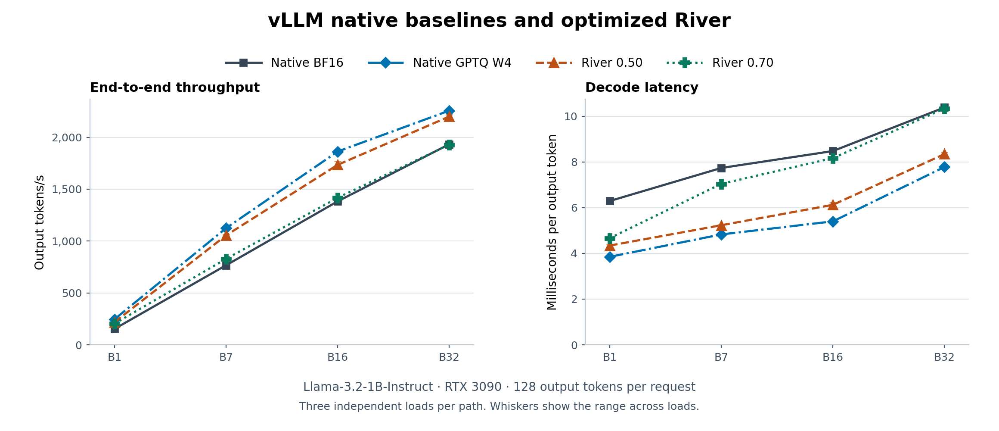

# River-vLLM

River-vLLM 把 River-LLM 的动态精度切换接入 vLLM 0.32 的原生解码 CUDA Graph。当前实现面向 Llama-3.2-1B-Instruct。Prefill 执行完整 BF16 主干。每个 decode 步根据当前批次选择 BF16 前缀的长度，再执行连续的 GPTQ W4 尾部。vLLM 管理分页 KV、输出头和采样。

## 与初版 Eager 融合相比

实验 1 复现了 Transformers 下的 River-LLM。实验 2–4 建立了 vLLM 的 BF16、HQQ 和 GPTQ 静态基线。实验 5 是本节的对照起点。它已接入原生 Model Runner V2、FA2、分页 KV 和采样器，使用 HQQ W4/G64 尾部、逐请求自适应 prefill 和逐请求动态 decode。阈值由 Eager 路径读取检查结果后在 Python 中决定。独立 trace 中动态路径的 CUDA Graph 重放次数为 0。RTX 3090 上 B1 固定生成 128 token 的动态 Eager 吞吐为 57.14 token/s。

| 技术变化 | 当前做法 |
|---|---|
| **1. 根据请求阶段执行完整 BF16 prefill** | 从 V2 调度状态读取每条请求的 prefill 标志和本步 token 数。单 token prompt 也按 prefill 处理。Prefill 使用 16 层 BF16 主干与最终 RMSNorm，decode 从每步的初始 BF16 状态重新判断。 [阶段跟踪](river_vllm/worker.py) |
| **2. 纯 prefill 快路径** | 整批都是 prefill 时直接进入 16 层 BF16 前向，省去通用路径的请求边界读回、路由器构造与逐层快照。B32 的同进程配对消融中，TTFT 平均减少 12.00 ms，384 对输出逐 token 一致。 [分派实现](river_vllm/eager.py) |
| **3. 批级共同退出** | 初版按请求独立选深度。当前在每个 BF16 层后计算残差重建向量的余弦相似度，所有活动 decode 行都严格超过阈值才切换。同一纯 decode 批次的投影因此使用同一精度。选中第 (d) 层后，前 (d) 层使用 BF16，随后各层使用 W4。末层结束后使用与 (d) 对应的 RMSNorm。16 个逻辑层都更新其原生分页 KV。 [条件解码器](river_vllm/conditional_decode.py) · [模型与共享 Attention](river_vllm/model.py) |
| **4. 混合步复用行索引** | 同批同时具有 prefill 和 decode 时走阶段感知 Eager 分派。每步从调度元数据建立两套行索引，并在后续混合层复用。Prefill 行继续执行 BF16，已退出的 decode 行走 W4。Attention 前恢复打包顺序，使一层的一份分页 KV 与原始槽位对齐。 [混合步实现](river_vllm/eager.py) |
| **5. GPTQ W4/G128 与原生 BF16 Marlin** | 采用对称 GPTQ、连续分组与 `desc_act=False`。将公开 GPTQ 权重的第 2–16 层 105 个投影接到完整 BF16 主干的尾部，加载后形成 60 个融合 Marlin 模块。整数权重在加载时重排为 Marlin `uint4b8`，FP16 scale 同期转成 BF16。矩阵乘法直接接收 BF16 激活，embedding、共享输出头、归一化参数和 KV 均为 BF16。 [GPTQ 适配](river_vllm/gptq.py) · [权重导出](tools/export_checkpoint.py) |
| **6. GPU 完整条件图** | 覆盖第 1–15 层退出和第 16 层结束。判断结果作为设备端条件节点的输入，一次原生图重放完成有效 decode 行的整段模型前向，逐层决定留在 GPU 上。隐藏状态由 vLLM 的输出头和采样器消费。 [条件节点](river_vllm/conditional_decode.py) |
| **7. 接入 vLLM V2 原生捕获与重放** | 通过自定义 worker 复用 V2 管理的输入 ID、位置、FA2 元数据、分页 KV 与图输出。相较此前独立持有的 River 图实现，省去图前六份暂存拷贝及独立 Python 重放提交。B32、阈值 0.70 的配对消融中，TPOT 从 11.034 降为 10.632 ms/token。 [原生图接线](river_vllm/native.py) |
| **8. 批容量分档与动态 KV 元数据** | 复用 V2 的捕获容量，B7 可以用 B8 图。填充行使用负 KV slot，由退出判定屏蔽。图使用统一的 2,048 token 上界，FA2 在重放时读取每条真实请求的序列长度与分页表。六档 B1/2/4/8/16/32 通过形状核验，B64 单独捕获后通过完整重放审计。 [图与元数据](river_vllm/native.py) · [有效行屏蔽](river_vllm/conditional_decode.py) |
| **9. 相邻层余弦归一化复用** | 当前 BF16 层输出的 L2 归一化向量直接用于下一层比较。最深路径的 15 次检查从 30 次向量范数降到 16 次。阈值 1.0 的 B32 消融测得约 0.176 ms/token 的节省。 [余弦检查](river_vllm/conditional_decode.py) |
| **10. Triton 融合退出判定** | 将 BF16 阈值比较、有效行过滤、批级归约和退出深度写入合成一个 Triton kernel，取代判定阶段的 7 个 kernel 和 1 次设备拷贝。支持 1–64 行，阈值相等的有效行按未通过处理。B32、阈值 0.70 的融合消融降低 0.169 ms/token。 [融合判定](river_vllm/conditional_decode.py) |
| **11. 任意深度退出后的连续 W4 尾部** | 每个 BF16 前缀检查点有互补的退出和继续条件。退出后进入该深度对应的连续 W4 分支，余下层直接执行。B32、阈值 0.70 的同进程配对中，TPOT 从 10.346 降为 10.214 ms/token，吞吐提高 0.82%，896 对输出逐 token 一致。 [连续尾部](river_vllm/conditional_decode.py) |

这些改动先后经过实验 7–12 和后续消融。实验 10 验证了固定形状、部分深度的独立 W4 尾部图。实验 11 对照了前两层精简图、完整条件图和混合步分派，并测试了 HQQ 参数的加载期预转换。实验 12 用同一 GPTQ 权重建立 Eager、精简图和完整图对照，再逐步完成 V2 原生重放和当前的连续 W4 尾部。

## 性能结果

以下为 RTX 3090 上的固定批次结果。各路径均用同步 V2、FA2、2 GiB BF16 分页 KV，greedy 固定生成 128 token 并忽略 EOS。吞吐按输出 token 数除以 `LLM.generate` 墙钟，加载、捕获和热身在计时前完成。BF16 对照使用 vLLM 原生编译与解码 CUDA Graph。[原始汇总字段及输入哈希](docs/measurements.json)

### 小批量与较低阈值

V2 原生重放、余弦归一化复用和 Triton 判定融合完成后的同轮四路对照，早于纯 prefill 快路径和连续 W4 尾部优化。每条路径独立加载三次。

| 批量 | 全量 BF16（token/s） | River 0.50（token/s） | 提升 |
|---|---:|---:|---:|
| B1 | 153.08 | 217.86 | 42.32% |
| B7 | 766.55 | 1,054.62 | 37.58% |
| B16 | 1,383.02 | 1,734.85 | 25.44% |
| B32 | 1,933.44 | 2,200.33 | 13.80% |



### 当前连续 W4 尾部版本

| 批量 | 阈值 | 同轮 BF16（token/s） | River（token/s） | 吞吐变化 |
|---|---:|---:|---:|---:|
| B32 | 0.70 | 1,945.16 | 1,955.87 | +0.55% |
| B64 | 0.70 | 2,529.52 | 2,508.55 | −0.83% |
| B64 | 0.50 | 2,532.27 | 2,590.85 | +2.31% |

B64 中，阈值 0.50 平均每步执行 13.74 层 W4，0.70 为 3.78 层。0.50 三轮吞吐分别领先 1.86%、2.77% 和 2.30%，合并 TPOT 从 13.008 降为 12.407 ms/token。两档 B64 均审计了每批的 127 个 decode 步，每步有 64 条活动请求。

实验 5 的历史 Eager 用 HQQ、逐请求退出和不同的输入与缓存预算。实验 12 的同 GPTQ 对照中，B1 Eager 为 59.72 token/s，当时的完整条件图为 200.23 token/s。表中速度结论对应同步调度与各自的阈值。任务质量按具体量化与阈值评估，逐 token 一致性数据对应各项配对优化。

## 运行方法

验证环境为 Linux x86-64、Python 3.11、vLLM 0.32.0/cu129、PyTorch 2.13.0/cu129 和单张 RTX 3090。原生 worker 绑定 vLLM `5df63a7203cdb9328d824a27b682e77c7b9928be` 的 V2 接口。在独立 Python 进程运行离线入口，采用 TP1/PP1、同步调度和 2,048 token 上下文。前缀缓存及分块 prefill 关闭。 [vLLM CUDA 安装文档](https://docs.vllm.ai/en/v0.32.0/getting_started/installation/gpu/)

```bash
uv venv --python 3.11
source .venv/bin/activate
vllm_wheel='https://github.com/vllm-project/vllm/releases/download/v0.32.0/vllm-0.32.0%2Bcu129-cp38-abi3-manylinux_2_28_x86_64.whl'
uv pip install "$vllm_wheel" --torch-backend=cu129
vllm download-kernels
uv pip install -e .
```

从如下固定版本获取 BF16 和 GPTQ 权重。导出工具复制主干和 GPTQ 投影，按已核验的映射构造 45 个 BF16 归一化张量。用归档的两份输入权重导出，得到 611 个张量。结果与实验使用的 `model.safetensors` 的 SHA-256 相同，为 `eefd7a950ece88ac3f729fcd73c5a1d3c2181e16541a279adf2348037c8566f6`。 [BF16 权重](https://huggingface.co/unsloth/Llama-3.2-1B-Instruct/tree/5a8abab4a5d6f164389b1079fb721cfab8d7126c) · [GPTQ 权重](https://huggingface.co/shuyuej/Llama-3.2-1B-Instruct-GPTQ/tree/4024c85b42b0a970040e96fb9f97987ab4adbd1c)

```bash
hf download unsloth/Llama-3.2-1B-Instruct \
  --revision 5a8abab4a5d6f164389b1079fb721cfab8d7126c --local-dir models/bf16
hf download shuyuej/Llama-3.2-1B-Instruct-GPTQ \
  --revision 4024c85b42b0a970040e96fb9f97987ab4adbd1c --local-dir models/gptq
python tools/export_checkpoint.py --base models/bf16 --gptq models/gptq --output models/river
python -m river_vllm --model models/river --threshold 0.50 --capture-sizes 1 \
  --batch-size 1 --max-tokens 32
```

使用已有 River GPTQ checkpoint 可直接传给 `--model`。B7 可指定 `--capture-sizes 1 2 4 8`，独立 B64 可指定 `--capture-sizes 64 --batch-size 64`。模型权重、2 GiB KV 与条件图显存分别占用空间，捕获容量按实际需要选择。六档 B1–32 的一次形状核验记录了 3.83 GiB 的私有图池。

发布目录使用归档 B64 输入逐 token 核验了阈值 0.50 和 0.70，各 64 条、每条 128 token。退出深度分布一致，且各有 127 个 V2 原生图重放。用 `python tools/check_runtime.py --model models/river` 核验 B1/B7 重放及混合步。原生捕获前会为混合步的 Eager 流初始化 Marlin 工作区。 [运行核验](tools/check_runtime.py)

源文件保留适用的版权声明。 [vLLM Apache-2.0 许可](LICENSES/Apache-2.0.txt)
